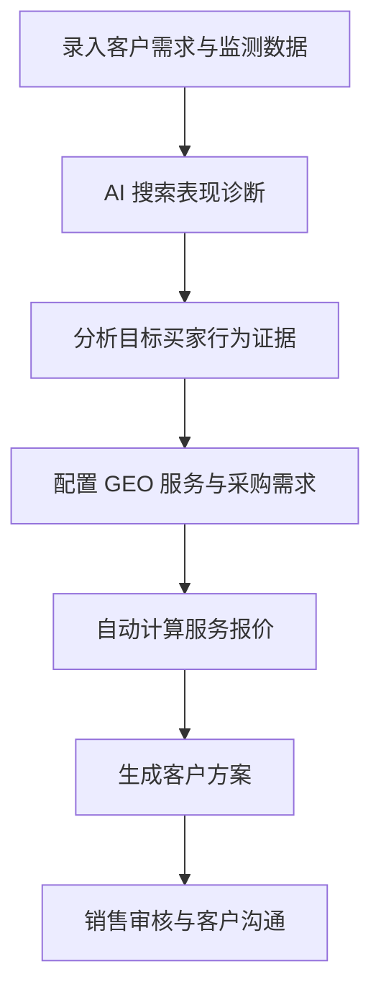

# Geo Buyer Evidence Studio|GEO 售前智能分析与方案生成工具

一个面向 B2B 企业 GEO（Generative Engine Optimization，生成式引擎优化）服务场景的售前辅助工具原型。通过整合 AI 搜索表现诊断、目标买家行为证据、服务报价计算与客户方案生成，帮助销售人员将分散的数据和客户需求转化为结构化、可解释、可交付的售前方案。

> 本项目为个人产品原型实践，围绕模拟客户需求与模拟监测数据构建，主要用于展示 GEO 业务理解、产品设计、数据分析和 AI 应用能力。

## 1. 项目背景

随着 ChatGPT、Google AI 等生成式 AI 产品逐渐成为用户获取信息的渠道，企业开始关注一个新的问题：
当潜在客户通过 AI 搜索产品或供应商时，自己的品牌是否能够被 AI 提及和推荐？

对于 GEO 服务销售人员而言，售前沟通通常需要回答四个问题：

- **数据表现：** 品牌目前在 AI 搜索结果中的可见度如何？
- **买家需求：** 目标客户是否已经开始使用 AI 搜索和筛选供应商？
- **服务报价：** 根据客户的业务需求，需要提供多少内容、哪些语种和多长时间的服务？
- **客户方案：** 如何将诊断结果、市场证据和报价整合成一份清晰的客户提案？

本项目围绕以上问题，将售前工作拆分为四个相互关联的功能模块。

## 2. 核心功能

### 2.1 AI 搜索表现诊断

对 ChatGPT 和 Google AI 两个平台的品牌提及数据进行结构化分析。

主要功能：

- 展示各平台发起查询数、有效回答数和品牌提及次数。
- 计算本品牌与竞品的提及率。
- 汇总两个平台的数据，计算整体品牌提及率。
- 展示核心指标及数据可视化结果。
- 提供指标解释和诊断结论。
- 设置数据校验规则，避免无效回答影响提及率计算。

**核心计算逻辑：**

品牌提及率 = 品牌提及次数 ÷ 有效回答数 × 100%

整体品牌提及率 = 两个平台品牌提及次数之和 ÷ 两个平台有效回答数之和 × 100%

**示例数据：**

| 指标 | ChatGPT | Google AI | 整体 |
|---|---:|---:|---:|
| 有效回答数 | 300 | 300 | 600 |
| 本品牌提及次数 | 36 | 54 | 90 |
| 本品牌提及率 | 12% | 18% | 15% |
| 竞品 A 提及次数 | 90 | 75 | 165 |
| 竞品 A 提及率 | 30% | 25% | 27.5% |

通过平台对比和竞品分析，帮助销售人员识别品牌在 AI 搜索场景中的可见度差距。

### 2.2 买家行为证据研究

围绕目标客户是否使用 AI 寻找供应商这一问题，建立可追溯的外部证据记录。

主要功能：

- 录入证据标题、来源链接、发布日期和调查对象。
- 记录研究结论及其对售前判断的支持作用。
- 将证据划分为直接证据、间接证据和证据缺口。
- 说明证据适用范围及局限性。
- 根据证据判断，为后续客户沟通和服务建议提供依据。

**证据判断原则：**

| 类型 | 判断标准 |
|---|---|
| 直接证据 | 研究对象、行业或采购行为与目标客户高度匹配 |
| 间接证据 | 能够提供相关趋势参考，但无法直接证明目标客户的实际行为 |
| 证据缺口 | 缺少足够资料，暂时无法支持相关判断 |

项目示例引入 Google 与 National Research Group 发布的 B2B 买家研究：

[Understanding the Empowered Buyer: A Playbook for Earning Trust in Today’s B2B Buyer Journey](https://www.nrgmr.com/resources/Google%20B2B%20Buyer%20Journey_October_2025.pdf)

该研究可作为 B2B 买家使用 AI 的趋势参考，但不能直接证明特定年龄段、工业设备采购人员或目标行业买家已经使用 ChatGPT、Google AI 寻找供应商。

因此，项目将其作为间接证据，并明确标记仍需进一步验证的目标人群和行业信息。

### 2.3 GEO 服务智能报价

根据客户的采购需求，自动计算 GEO 服务内容数量和费用。

支持录入和调整：

- 核心业务场景数量
- 内容覆盖语种
- 内容覆盖周期
- 专项监测周期
- PR 等增值服务

**模拟报价规则：**

| 服务项目 | 计价规则 |
|---|---:|
| 国际 GEO 内容 | 180 元 / 页 |
| 专项监测 | 12,000 元 / 周 |
| PR 服务 | 待确认 |

**计算逻辑：**

内容页数 = 核心场景数 × 语种数量

内容费用 = 内容页数 × 单页价格

监测费用 = 监测周数 × 每周价格

已确认小计 = 内容费用 + 监测费用

**示例采购需求：**

- 60 个核心场景
- 英语、西班牙语、法语 3 种语言
- 内容覆盖周期：3 个月
- 专项监测周期：2 周
- PR 服务：待确认

| 报价项目 | 计算方式 | 金额 |
|---|---|---:|
| GEO 内容 | 60 × 3 × 180 | ¥32,400 |
| 专项监测 | 2 × 12,000 | ¥24,000 |
| PR 服务 | 待确认 | 待确认 |
| **已确认小计** | | **¥56,400** |

报价采用人民币、不含税口径。

其中，内容覆盖周期用于描述内容建设计划，不直接参与费用计算；专项监测周期独立计费。PR 由于缺少确认单价，单独列示，不计入已确认小计。

### 2.4 客户方案生成

将前面三个模块的信息整合为一份结构化客户方案。

方案内容包括：

- 客户品牌当前 AI 搜索表现
- 品牌与竞品的提及率对比
- 目标买家使用 AI 的相关证据
- 当前证据支持程度与待验证问题
- 推荐的 GEO 内容场景和语种
- 服务交付范围与周期
- 服务报价明细及已确认小计

客户方案与数据诊断、服务报价保持一致。当销售人员调整采购场景数量、语种或监测周期时，相关报价和方案内容应同步更新。

支持将方案复制或导出，便于后续售前沟通。

## 3. 产品业务流程

四个模块并非相互独立的工具，而是围绕售前工作流程形成信息衔接：

- 数据诊断提供品牌表现依据。
- 买家研究提供市场需求依据。
- 智能报价将客户需求转化为可量化的服务范围。
- 客户方案整合前述信息，形成售前交付材料。

## 4. 项目实践重点

本项目重点体现以下能力：

**业务流程拆解**

将 GEO 售前工作拆解为数据诊断、买家研究、服务配置和方案输出四个阶段，明确各阶段的输入、处理逻辑与输出。

**数据分析与规则设计**

围绕品牌提及率、有效回答数、竞品对比和报价计算设计可解释的业务规则，避免只展示结果而缺乏计算依据。

**证据驱动的产品设计**

将外部研究纳入售前判断流程，区分直接证据、间接证据和证据缺口，避免将趋势性数据误认为目标客户的实际行为。

**AI 应用与原型开发**

利用 Lovable 进行 Vibe Coding，快速将业务需求转化为可交互的 Web 产品原型，验证功能流程与信息组织方式。

## 5. 技术与工具

| 工具 | 用途 |
|---|---|
| Lovable | AI 辅助应用开发与交互原型搭建 |
| GitHub | 项目代码管理与版本记录 |
| AI 大语言模型 | 辅助需求梳理、业务逻辑设计和内容整理 |

本项目以可演示的产品原型为目标，重点验证售前业务流程和核心功能，不将其描述为已经具备完整生产环境能力的商业系统。

## 6. 项目定位与适用场景

**目标用户：** GEO 服务公司的销售人员、售前顾问及业务运营人员。

**适用场景：**

- GEO 服务售前需求分析
- 企业 AI 搜索表现初步诊断
- B2B 买家行为证据整理
- GEO 服务组合与报价测算
- 客户提案内容整理与生成

**项目目标：**

将原本分散在数据表格、市场研究和人工报价流程中的信息，整合为一套可操作、可解释、可复用的 GEO 售前辅助工具。

## 7. 项目链接

- GitHub Repository：https://github.com/1240276725-create/geo-buyer-evidence-studio
- Live Demo：[在线体验](https://pixel-perfect-snapshot-5512.lovable.app/)

---

*Personal Project · GEO Sales Enablement · AI Product Prototype*
